# Otsu thresholding and mean shift segmentation in C++

A C++/OpenCV program that segments an image with three classical methods: Otsu thresholding into 2 classes, Otsu thresholding into 4 classes, and mean shift filtering and segmentation (Comaniciu and Meer, 2002). The methods group pixels by grey level or colour alone. This is classical, unsupervised segmentation, not semantic segmentation: nothing is learned, and no pixel gets a label such as "road" or "person".

Michael Perez wrote the program for Assignment 3 of CAP 4410 Computer Vision, Florida Polytechnic University, fall 2019, with the mean shift class adapted from [bbbbyang/Mean-Shift-Segmentation](https://github.com/bbbbyang/Mean-Shift-Segmentation) by Bingyang Liu and the four-class Otsu search taken from a Stack Overflow question (see [Credits](#credits)). In 2026 the bugs in all three methods were fixed, the four-class Otsu search was replaced by new code, and a CMake build, command-line options, a headless mode, tests and CI were added.

## Results

The images below were written by `./build/segment --no-gui --method <method> --out docs/images <image>` from the 150×150 sample images in [`images/`](images), which the assignment grouped by method. The numbers are the ones the program printed. η is Otsu's separability measure, the fraction of the image's grey-level variance that the classes explain.

### Otsu thresholding, 2 classes

| | south_L | edge_L | blocks_L |
| --- | --- | --- | --- |
| Input | 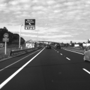 |  | 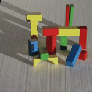 |
| 2 classes | 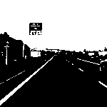 | 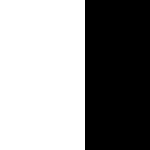 | 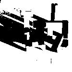 |
| Threshold | 132 (η = 0.938) | 172 (η = 0.996) | 109 (η = 0.662) |

Grey levels up to the threshold become black, the others white. The third image of the assignment's set, the portrait andreas_L, gives a threshold of 67 (η = 0.806). For a colour image the program also thresholds the B, G and R channels separately, as the 2019 version did, which gives up to 8 colours. On blocks_L the channel thresholds are B 98, G 106 and R 115:

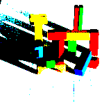

### Otsu thresholding, 4 classes

| S01 | S04 | S05 | blocks_L |
| --- | --- | --- | --- |
| 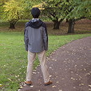 | 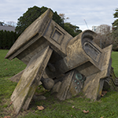 | 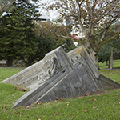 |  |
| 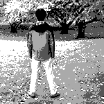 | 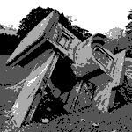 | 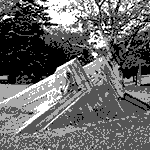 | 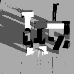 |

The classes are drawn as grey levels 0, 85, 170 and 255. The 2019 version scored only three of the four classes, so its brightest class was nearly empty. Each image has 22,500 pixels; the 2019 values come from its code compiled unchanged, on the first press of key 2.

| Image | 2019 thresholds | 2019 brightest class | 2019 η | Thresholds now | Brightest class now | η now |
| --- | :---: | ---: | ---: | :---: | ---: | ---: |
| S01 | 85, 131, 255 | 3 px | 0.806 | 66, 103, 138 | 4,546 px | 0.879 |
| S04 | 78, 156, 255 | 14 px | 0.898 | 59, 102, 169 | 3,808 px | 0.951 |
| S05 | 82, 149, 255 | 53 px | 0.822 | 71, 115, 168 | 2,028 px | 0.890 |
| blocks_L | 74, 118, 194 | 13 px | 0.791 | 72, 114, 159 | 1,197 px | 0.909 |

The thresholds of all twelve sample images, which the tests check:

| Image | 2 classes | η | 4 classes | η |
| --- | ---: | ---: | :---: | ---: |
| S00 | 79 | 0.566 | 56, 91, 144 | 0.868 |
| S01 | 101 | 0.605 | 66, 103, 138 | 0.879 |
| S02 | 161 | 0.786 | 65, 103, 183 | 0.963 |
| S03 | 134 | 0.753 | 52, 94, 165 | 0.943 |
| S04 | 137 | 0.757 | 59, 102, 169 | 0.951 |
| S05 | 116 | 0.566 | 71, 115, 168 | 0.890 |
| andreas_L | 67 | 0.806 | 39, 75, 119 | 0.945 |
| blocks_L | 109 | 0.662 | 72, 114, 159 | 0.909 |
| edge_L | 172 | 0.996 | 171, 172, 189 | 1.000 |
| set1Seq2_L | 144 | 0.732 | 84, 141, 187 | 0.940 |
| set2Seq1_L | 154 | 0.679 | 87, 147, 184 | 0.897 |
| south_L | 132 | 0.938 | 75, 152, 214 | 0.980 |

### Mean shift

| Input | Filtered | Segmented | Region boundaries |
| --- | --- | --- | --- |
| 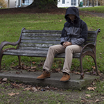 | 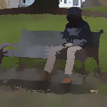 | 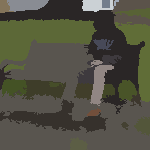 | 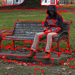 |
| 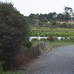 | 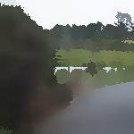 | 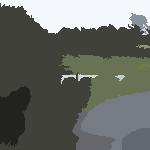 | 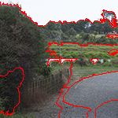 |
| 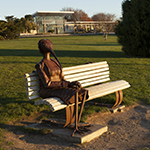 | 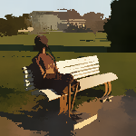 | 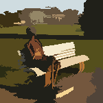 | 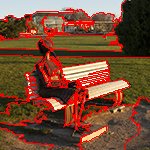 |
| 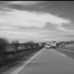 | 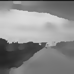 | 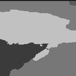 | 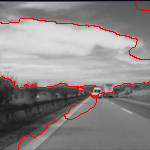 |
| 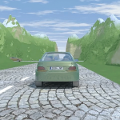 | 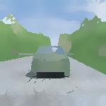 | 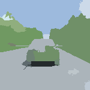 | 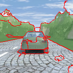 |

With the default bandwidths, hs = 8 pixels and hr = 16 (in L\*a\*b\*), every pixel converged:

| Image | Steps per pixel (mean, max) | Regions grown | Regions after merging those under 20 pixels |
| --- | :---: | ---: | ---: |
| S00 | 6.91, 44 | 145 | 29 |
| S02 | 4.41, 36 | 76 | 14 |
| S03 | 6.68, 38 | 336 | 48 |
| set1Seq2_L | 3.58, 33 | 17 | 6 |
| set2Seq1_L | 5.01, 28 | 52 | 15 |

The segmented images show each region in its mean filtered colour; the boundary images mark in red the pixels whose right or lower neighbour belongs to another region.

## How it works

### Otsu thresholding (`Otsu.cpp`)

Colour images are first converted to grey with OpenCV's weights (0.299 R + 0.587 G + 0.114 B). Otsu's method then picks the thresholds that maximise the between-class variance of the grey-level histogram, σ<sub>B</sub>² = Σ<sub>k</sub> ω<sub>k</sub> (μ<sub>k</sub> − μ)², where ω<sub>k</sub> is the fraction of the pixels in class k, μ<sub>k</sub> their mean level and μ the mean level of the image.

- If class k has N<sub>k</sub> pixels whose levels add up to S<sub>k</sub>, then σ<sub>B</sub>² = (Σ<sub>k</sub> S<sub>k</sub>²/N<sub>k</sub>)/N − μ² for N pixels, so only Σ<sub>k</sub> S<sub>k</sub>²/N<sub>k</sub> has to be compared. With cumulative sums of the histogram each term takes two subtractions, and every set of thresholds is tried: 255 for 2 classes and C(255, 3) ≈ 2.7 million for 4 classes.
- Class k holds the levels v with t<sub>k−1</sub> < v ≤ t<sub>k</sub>, so a pixel equal to a threshold is in the lower class, as with `cv::threshold`. The search, the class sizes and the output image all use these boundaries. When several thresholds give the same classes because the levels between them are empty, the lowest is reported.
- The program prints η = σ<sub>B</sub>²/σ<sub>T</sub>², where σ<sub>T</sub>² is the variance of the whole image, and the size of each class.
- With 2 classes the split is the same as that of `cv::threshold` with `THRESH_OTSU`, which the tests check. `ThresholdChannels` applies it to each channel of a colour image.

### Mean shift (`MeanShift.cpp`)

The image is converted to CIE L\*a\*b\* in floating point (L from 0 to 100), where Euclidean distances roughly follow perceived colour differences. Each pixel is a point (x, y, L, a, b) of the joint spatial-colour domain. The spatial bandwidth hs (`--hs`, default 8 pixels) and the colour bandwidth hr (`--hr`, default 16) are the radii of the windows in the two domains.

1. **Filtering** (`MSFiltering`). For each pixel, a window starts at the pixel's position and colour. It holds the pixels within hs of the window's centre in the image (a disc) and within hr of its colour. The centre moves to the mean position and colour of those pixels, and this repeats until both the position and the colour move by at most 0.3 (pixels and L\*a\*b\* units), for at most 100 steps. The pixel then takes the colour of the point it converged to, its mode.
2. **Region growing** (`MSSegmentation`). Regions are grown from seed pixels taken in raster order: an 8-connected neighbour joins a region when its filtered colour is within hr of the seed's.
3. **Merging small regions.** While some region has fewer than M pixels (`--min-region`, default 20), the smallest one is merged into the neighbouring region with the closest mean colour. This is the last, optional step of Comaniciu and Meer's segmentation.

### Differences from Comaniciu and Meer

- Only the uniform kernel (a flat window) is used.
- The paper groups the pixels whose modes lie within hs and hr of each other. The region growing kept from the original code compares each pixel with the seed of its region instead, so the regions depend on the order of the scan. Linking neighbouring pixels whose filtered colours are close was tried instead, but it chained colours along smooth gradients into very large regions; on S02, most of the image became one region.
- Each pixel is filtered on its own; there are no speed-ups such as giving the pixels passed on the way the same mode.

## Building

Requirements: CMake 3.16 or later, a C++17 compiler, and OpenCV 4 with the core, imgproc, imgcodecs and highgui modules.

Ubuntu or Debian:

```sh
sudo apt-get install build-essential cmake libopencv-dev
cmake -S . -B build -DCMAKE_BUILD_TYPE=Release
cmake --build build
```

macOS with Homebrew:

```sh
brew install cmake opencv
cmake -S . -B build -DCMAKE_BUILD_TYPE=Release
cmake --build build
```

conda-forge (Linux or macOS, with the system compiler):

```sh
conda create -n segmentation -c conda-forge cmake make libopencv
conda activate segmentation
cmake -S . -B build -DCMAKE_BUILD_TYPE=Release -DCMAKE_PREFIX_PATH="$CONDA_PREFIX"
cmake --build build
```

CI builds against Ubuntu's OpenCV packages. The code has also been built and tested with OpenCV 4.6 and 4.11 from conda-forge on macOS (Apple Clang 17), and it compiles without warnings with GCC 14 and 15.

## Running

```
./build/segment [options] [image]
```

| Option | Meaning |
| --- | --- |
| `image` | Input image (default: `images/otsu4/blocks_L-150x150.png`, relative to the current directory) |
| `--method M` | `otsu2`, `otsu4`, `meanshift` or `all` (default `all`) |
| `--hs N` | Mean shift spatial bandwidth in pixels, 1 to 50 (default 8) |
| `--hr N` | Mean shift colour bandwidth in L\*a\*b\* units, 1 to 100 (default 16) |
| `--min-region N` | Merge mean shift regions smaller than N pixels, 0 to 1,000,000 (default 20; 0 merges nothing) |
| `--out DIR` | Write the result images to `DIR` |
| `--no-gui` | Do not open windows: run the method or methods, write the images (to `./output` unless `--out` is given) and exit |

Without `--no-gui` the program shows the input image. As in 2019, press 1 for Otsu with 2 classes, 2 for Otsu with 4 classes and 3 for mean shift, each of which opens its result windows; press q or Esc to quit. A method given with `--method` also runs at the start. Both modes print the results: for Otsu the thresholds, η and (for the grey-level image) the class sizes; for mean shift the statistics shown under [Results](#mean-shift). The images written are named after the input file: `<name>_otsu2.png`, `<name>_otsu2_channels.png` (colour images only), `<name>_otsu4.png`, `<name>_meanshift_filtered.png`, `<name>_meanshift_segmented.png` and `<name>_meanshift_boundaries.png`.

```sh
./build/segment images/otsu4/S01-150x150.png             # windows
./build/segment --no-gui images/otsu4/S01-150x150.png    # writes ./output/S01-150x150_*.png
./build/segment --no-gui --method meanshift --hs 6.5 --hr 7 --out results photo.jpg
```

The mean shift filter is meant for small images: its cost grows with the number of pixels, with the area of the window (hs²) and with the number of steps. On a 2019 laptop (Intel Core i7-9750H), filtering and segmenting one of the 150×150 samples takes from 0.04 s (edge_L) to 0.3 s (S05), and S03 enlarged to 640×480 about 2 s. The 4-class Otsu search takes about 8 ms, the 2-class one less than 1 ms. The program prints the time of each method; for mean shift it leaves out the conversion to L\*a\*b\*, because the first conversion in a process also builds OpenCV's lookup tables, which takes a few tenths of a second.

## Tests

```sh
(cd build && ctest --output-on-failure)
```

`tests/test_otsu.cpp`:

- an image of four noisy grey bands gives each band its own class, with each threshold at the brightest level of its band;
- on 79 random histograms (2 to 256 levels, 2 to 4 classes, including sparse ones with several equally good answers), the thresholds score as well as the best of every possible set, scored separately with the textbook formula; for 4 classes of 256 levels all 2.7 million sets are tried;
- the twelve sample images give the 2- and 4-class thresholds and the 4-class η listed under [Results](#otsu-thresholding-4-classes), which a separate exhaustive search in Python (NumPy) also found, and their brightest class is not nearly empty;
- calling the search again, also after another image, gives the same thresholds (the 2019 histogram was never cleared);
- with 2 classes, 54 images (random ones, and the grey version and every channel of each sample image) are split exactly as `cv::threshold` with `THRESH_OTSU` splits them;
- a pixel equal to a threshold goes to the lower class, and the class sizes and σ<sub>B</sub>² of the class image match those of the search;
- the per-channel method matches `cv::threshold` on each channel;
- constant images, one-pixel images and invalid arguments.

`tests/test_meanshift.cpp`:

- the L\*a\*b\* values of pure blue, red, green, white and black are right (blue has b\* ≈ −108; with red and blue swapped it would get the +67 of red), and 8-bit colours survive the round trip;
- four noisy flat colours give four regions, one per quadrant, with colours within 1 ΔE of the true ones; without noise, the segmentation alone reproduces the image;
- two blues 5.7 apart in L\*a\*b\* form one region; measured with red and blue swapped, as in 2019, they are 31 apart and split in two;
- sampled pixels reach the same mode as a separate implementation of the filter written in the test (at least 99% of them, since rounding can tip the stopping test of a rare pixel either way);
- flipping or transposing an image flips or transposes the filtered result, which the 2019 window, one pixel short on two sides, did not;
- regions under M pixels join the neighbour closest in colour, and a region with no neighbour stays;
- on the five mean shift sample images every pixel converges and no region is smaller than M (for M = 20 and 50);
- invalid arguments and a one-pixel image.

Putting the 2019 behaviour of the four-class search, the histogram, the class boundaries, the colour conversion, the mean shift window, its stopping rule or the region merging back into a copy of the code, one at a time, makes at least one of these tests fail. ctest also runs the program with `--no-gui` on all twelve sample images, checks that `--method otsu2` and `--method otsu4` run only that method and print its results, and checks its error messages for a missing image, an unknown method, a bandwidth or minimum region size out of range, an unknown option and an output path that is not a directory.

## Credits

- The mean shift code (`MeanShift.h`, `MeanShift.cpp`) is adapted from [bbbbyang/Mean-Shift-Segmentation](https://github.com/bbbbyang/Mean-Shift-Segmentation) by Bingyang Liu (2015). That repository has no license file, so none is added here.
- The four-class Otsu search of the 2019 version came from the Stack Overflow question [multi-level (4) Otsu thresholding](https://stackoverflow.com/questions/35056760/multi-level-4-otsu-thresholding) (natan337, 2016); `Otsu.cpp` is new code.
- N. Otsu, "A Threshold Selection Method from Gray-Level Histograms", *IEEE Transactions on Systems, Man, and Cybernetics* 9(1), 62–66, 1979. doi:[10.1109/TSMC.1979.4310076](https://doi.org/10.1109/TSMC.1979.4310076).
- D. Comaniciu and P. Meer, "Mean Shift: A Robust Approach Toward Feature Space Analysis", *IEEE Transactions on Pattern Analysis and Machine Intelligence* 24(5), 603–619, 2002. doi:[10.1109/34.1000236](https://doi.org/10.1109/34.1000236).
- The sample images, provided with the assignment, are 150×150 thumbnails from the [stereo pairs page](https://web.archive.org/web/20230923082221/https://ccv.wordpress.fos.auckland.ac.nz/data/stereo-pairs/) (archived copy) of the website of Reinhard Klette's book *Concise Computer Vision* (Springer, 2014), where he released them into the public domain in January 2014.

## 2019 report

[Report.docx](Report.docx) is the original write-up submitted for the assignment in October 2019. It describes the code as it was then, and its figures come from that code.
